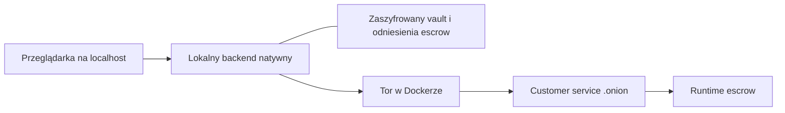

# Plan lokalnego dashboardu Nexum w Dockerze

Lokalny dashboard prowadzi użytkownika przez połączenie z Torem,
zatwierdzenie challenge i podgląd istniejącego escrow. Użytkownik nie
zakłada konta, nie rejestruje nicku i nie loguje się. Hasło odblokowuje
lokalny vault na czas podpisania wyzwania.

Status: plan do implementacji, przyjęty 2026-10-11. Klasyfikacja:
**MANUAL** dla interfejsu i zatwierdzenia podpisu, **OPS** dla Docker,
**CORE** dla dostosowania kontraktu klienta do modelu bez kont.

Architekturę określa [Source of Truth](../NXMS_STACK_SOURCE_OF_TRUTH.md),
sekcje 8a–8c. Aktywne zadania są wyłącznie w
[roadmapie](../NXMS_ROADMAP.md). Poniższe etapy opisują kolejność wykonania
i warunki odbioru; nie są drugą checklistą projektu.

## Zakres pierwszej wersji

- Lokalny interfejs w przeglądarce, dostarczony razem z programem w Dockerze.
- Automatyczne zestawienie połączenia przez Tor.
- Obsługa lokalnego vaulta, hasła i świadomego podpisania challenge.
- Podgląd escrow, do którego klucz użytkownika ma już przypisane uprawnienia.
- Czytelny stan połączenia, historia zdarzeń i czas ostatnich poprawnych danych.
- Wolne narzędzie, możliwe do samodzielnego uruchamiania; bez obowiązkowej subskrypcji klienta.

Pierwsza wersja nie otwiera escrow, nie zgłasza `delivered`, nie zleca
zwrotu i nie podpisuje ani nie wysyła transakcji Monero. Te czynności
pozostają w istniejącym modelu runtime i ewentualnych późniejszych etapach
interfejsu. Podpis challenge służy wyłącznie dostępowi do podglądu.

WASM, integracja nowego FreeFT oraz pełny review historycznego `nexum-cli`
pozostają odłożone. Plan nie zmienia quorum guardów, admission ani reguł
automatycznego multisig.

## Podział programu

Backend dostarcza pliki GUI i lokalne API z tego samego adresu. Przeglądarka
nie łączy się samodzielnie z usługami zewnętrznymi. Backend otwiera vault,
podpisuje zatwierdzone wyzwanie i komunikuje się z customer service przez
Tor. Wymiana między hostami korzysta z kanonicznego `NxmsEnvelope`.

Customer service sprawdza prawo danego klucza do podglądu escrow i zwraca
jego stan. Mailbox pozostaje relayem; nie staje się API statusu ani źródłem
prawdy workflow. Podpisywanie challenge jest odrębne od podpisywania
transakcji przez signery runtime.

## Przebieg użytkownika

| Ekran | Co widzi użytkownik | Działanie |
| --- | --- | --- |
| Start | Stan lokalnego programu i postęp łączenia z Torem | Program łączy się automatycznie; błąd daje możliwość ponowienia. |
| Vault i escrow | Wybrana lokalna tożsamość oraz wskazane escrow | Wybór istniejącego vaulta i import zaufanego odniesienia escrow. |
| Challenge | Usługa, identyfikator escrow, cel odczytu i ważność wyzwania | Użytkownik sprawdza dane. |
| Potwierdzenie | Pole hasła i przyciski „Zatwierdź podpis” oraz „Anuluj” | Backend odblokowuje vault, podpisuje dokładnie zatwierdzone wyzwanie i usuwa materiał odblokowania. |
| Podgląd escrow | Stan procesu, kwota, finansowanie, historia i świeżość danych | Program odświeża podgląd w granicach ważnego uprawnienia. |
| Przerwa lub blokada | Powód przerwy i ostatni poprawny stan | Ponowienie połączenia, nowe zatwierdzenie challenge lub lokalna blokada. |

Pierwsze przygotowanie nowego vaulta może mieć osobny lokalny kreator
hasła i kluczy. To nie tworzy konta w usłudze. Dla istniejącego escrow
potrzebny jest jego dotychczasowy klucz; utworzenie nowego vaulta nie
przywraca dostępu. Brak klucza daje komunikat o konieczności odzyskania
właściwego vaulta, bez cichego generowania zamiennika.

Użytkownik nie wybiera algorytmu KEM, nie wpisuje opcji SOCKS i nie
przekleja JSON ani podpisu. Profile kryptograficzne oraz adres usługi
wynikają z zatwierdzonej konfiguracji i odniesienia escrow. Błąd profilu
kończy się czytelną odmową, a nie automatycznym wyborem innego algorytmu.

## Powiązanie klucza z escrow

Przed implementacją trzeba ustalić format zaufanego odniesienia escrow.
Ma ono wskazywać co najmniej usługę `.onion`, `escrow_id`, zaufaną
tożsamość usługi i publiczny klucz uprawnionej strony lub podpisaną
referencję do odpowiedniego snapshotu. Importowany adres jest sprawdzany
względem konfiguracji zaufania; sam plik zaproszenia nie ustanawia trustu.

Usługa porównuje proof z kluczem przypiętym do snapshotu tego escrow.
Znajomość identyfikatora escrow i podpis wykonany dowolnym nowym kluczem
nie wystarczają do odczytu. Nie używamy `register/login`, nicku ani
trwałego konta jako warunku tego sprawdzenia.

Mechanizm dostarczenia takiego odniesienia i migracja istniejących
snapshotów są zależnościami pierwszego etapu. Dopóki nie istnieje zgodny
kontrakt po stronie customer service, GUI korzysta wyłącznie z jawnie
oznaczonych danych syntetycznych.

## Challenge i hasło

Kontrakt wyzwania musi wiązać identyfikator wyzwania, losowy nonce,
tożsamość i adres usługi, `escrow_id`, publiczny klucz klienta, zakres
`escrow:read`, czas wydania i wygaśnięcia oraz wersję protokołu i profil
podpisu. Usługa uwierzytelnia wyzwanie; klient sprawdza je względem
zaufanej tożsamości usługi. Dokładne bajty podpisu, powiązanie z
`NxmsEnvelope` i sposób potwierdzenia tożsamości muszą mieć wspólne
wektory testowe dla obu stron.

Przebieg techniczny:

1. Backend pobiera i sprawdza publicznie weryfikowalne metadane challenge oraz tożsamość usługi, zanim poprosi o hasło. Fragment wymagający prywatnego klucza KEM może odszyfrować dopiero po odblokowaniu, chyba że wyzwanie jest kierowane do osobnego klucza kanału odczytu.
2. GUI pokazuje sens operacji; backend zachowuje dokładne wyzwanie pod lokalnym identyfikatorem.
3. Użytkownik podaje hasło i zatwierdza ten identyfikator wyzwania.
4. Backend ponownie sprawdza ważność i zgodność wyzwania, odblokowuje vault i tworzy pojedynczy podpis.
5. Hasło i odszyfrowany klucz są usuwane z pamięci, a proof trafia przez Tor do usługi.
6. Usługa sprawdza podpis, uprawnienie klucza do escrow i jednorazowość challenge.
7. Usługa wydaje krótkotrwałe uprawnienie tylko do odczytu tego escrow; backend trzyma je i niezbędny materiał kanału odczytu w pamięci, zgodnie z kontraktem lifecycle.

Obecny `nxms-transport` potrzebuje prywatnego klucza podpisu do wysłania
koperty i prywatnego klucza KEM do jej odszyfrowania. Sam token odczytu
nie wystarcza więc do odświeżania po usunięciu kluczy vaulta. Etap 1 musi
rozstrzygnąć i sprawdzić lifecycle kanału odczytu przed implementacją GUI
z prawdziwymi sekretami.

Proponowany kierunek to klucze efemeryczne kanału przechowywane wyłącznie
w pamięci, których publiczna część jest powiązana zatwierdzonym podpisem
tożsamości z usługą, escrow, zakresem odczytu i terminem ważności.
Trzeba określić obsługę tego powiązania w transporcie oraz weryfikację
przez usługę; obecna implementacja nie zapewnia go automatycznie.
Automatyczne podpisy kopert takim kluczem nie uprawniają do operacji na
escrow ani podpisu transakcji. Nowy podpis długoterminową tożsamością
wymaga kolejnego świadomego zatwierdzenia. Blokada, wygaśnięcie i restart
usuwają uprawnienie oraz prywatne klucze kanału.

Hasło nie trafia do usługi zdalnej. Przeglądarka przekazuje je wyłącznie
do lokalnego backendu i nie utrwala go w storage. Klucz prywatny nie
trafia do JavaScriptu ani odpowiedzi API. Hasło, klucze i tokeny nie
występują w argumentach procesów, zmiennych środowiskowych, logach
ani trwałych plikach tymczasowych. W implementacji należy ograniczyć
kopie sekretów i sprawdzić ich lifecycle, bez obietnicy gwarantowanego
wymazania pamięci przeglądarki.

Anulowanie, błędne hasło lub wygaśnięcie pozostawiają vault zablokowany.
Podwójne kliknięcie nie powoduje dwóch podpisów. Wygaśnięcie uprawnienia
nie uruchamia automatycznego podpisywania nowego challenge. Przycisk
„Zablokuj” usuwa lokalne uprawnienie i klucze kanału oraz zatrzymuje
odświeżanie. Zamknięcie
GUI nie kończy escrow w runtime; wygaśnięcie uprawnienia ma ograniczać
jego życie także bez zdarzenia zamknięcia karty.

## Podgląd i utrata połączenia

Panel pokazuje identyfikator escrow, rolę użytkownika, uzgodnioną kwotę
i warunki widoczne w snapshotcie, adres wpłaty, stan finansowania,
etap workflow, terminy oraz uporządkowaną historię. Każdy stan ma czas
danych z usługi i czas ostatniego poprawnego odświeżenia lokalnego.

Stan Tora, ważność uprawnienia i stan escrow są osobnymi informacjami.
Awaria połączenia nie oznacza niepowodzenia escrow. GUI zachowuje
ostatni poprawny widok z oznaczeniem nieaktualnych danych; adres wpłaty
i informacje o finansowaniu mają tę samą informację o świeżości.

Odświeżanie jest ograniczone do jednego żądania naraz, z ponowieniami
w rosnących odstępach. Powtórzona lub starsza odpowiedź nie cofa
potwierdzonego stanu. Kontrakt statusu musi zdefiniować wersję lub numer
zdarzenia pozwalający wykryć taką odpowiedź. Widok przedstawia stan
potwierdzony przez usługę; nie udaje niezależnej walidacji blockchaina.

## Lokalne API

Nazwy tras są propozycją dla adaptera lokalnego, nie istniejącym API:

| Operacja | Zakres |
| --- | --- |
| `GET /api/local/health` | Stan lokalnego programu i Tora, bez sekretów. |
| `POST /api/local/escrow/select` | Wybór zaufanego odniesienia escrow i lokalnego vaulta. |
| `POST /api/local/challenge/prepare` | Pobranie i weryfikacja wyzwania; zwrot szczegółów do pokazania. |
| `POST /api/local/challenge/confirm` | Identyfikator zatwierdzonego wyzwania i hasło; pojedynczy podpis. |
| `GET /api/local/escrow/status` | Ostatni stan dostępny w ramach uprawnienia odczytu. |
| `POST /api/local/lock` | Usunięcie lokalnego uprawnienia i blokada. |

GUI i API mają jeden lokalny origin. Backend sprawdza `Host` i `Origin`,
chroni operacje POST przed CSRF oraz stosuje lokalny token żądań,
ograniczenia rozmiaru i tempa. To ochrona lokalnego interfejsu,
bez tworzenia kont użytkowników. Nie udostępniamy ogólnego wykonania
komend, endpointu shell ani API administracyjnego Dockera.

## Docker i dane

Proponowane dwie usługi Compose:

- `dashboard`: natywny backend i lokalne pliki GUI, zaszyfrowany vault oraz odniesienia escrow w trwałym wolumenie;
- `tor`: SOCKS dostępny tylko w prywatnej sieci kontenerów, ze stanem połączenia pokazywanym przez backend.

Na hoście publikowany jest wyłącznie panel, np. `127.0.0.1:8787:8787`.
Backend nasłuchuje na interfejsie wewnątrz kontenera, do którego Docker
mapuje port; granicą ekspozycji jest hostowy loopback. SOCKS nie jest
publikowany na hoście. Dashboard ma tylko prywatną sieć do Tora;
wyłącznie kontener Tora ma wyjście zewnętrzne. Trzeba potwierdzić brak
bezpośredniego wyjścia dashboardu w rzeczywistym teście sieciowym.

Backend używa rozwiązywania nazw przez Tor i dopuszcza zatwierdzone
adresy onion. Niedostępność Tora kończy się stanem offline, bez
fallbacku do clearnetu. Usługi nie otrzymują socketu Dockera,
`privileged`, sieci hosta ani katalogów innych projektów. Proces
dashboardu działa jako użytkownik bez uprawnień administratora.

Obrazy runtime zawierają gotowe programy. Instalacja użytkownika nie
wymaga Cargo, kompilatora ani synchronizacji własnego `monerod`.
Nie wykorzystujemy kontenera developerskiego jako finalnego produktu.
Panel dostarcza lokalnie skrypty, style i zasoby, bez CDN i analityki.

Dane klienta są oddzielone od stagenetu, guardów i signerów. Na tym
laptopie korzystają z istniejącej lokalizacji danych Dockera na drugiej
partycji. Restart zachowuje zaszyfrowany vault i odniesienia escrow,
ale usuwa odblokowanie i uprawnienia z pamięci. Aktualizacja obrazu
nie usuwa wolumenu; usunięcie vaulta wymaga osobnej jawnej operacji.

Limity CPU, pamięci, procesów i logów dobieramy po pomiarze działania
vaulta oraz podpisu. Jedna operacja kryptograficzna naraz; buildy i testy
na laptopie kolejno, kompilacja z jednym zadaniem. Runtime nie wykonuje
kompilacji podczas zwykłego uruchamiania.

## Kolejność implementacji i odbiór

| Etap | Rezultat | Warunek przejścia dalej |
| --- | --- | --- |
| 1 Kontrakt klienta | Deskryptor escrow, powiązanie klucza, challenge, proof, uprawnienie odczytu, klucze kanału i wersjonowany status | Klient i usługa mają uzgodnione formaty oraz przypadki odmowy; automatyczne odświeżanie ma jawny lifecycle kluczy, bez `register/login` i utrzymywania odblokowanego vaulta. |
| 2 Prototyp GUI | Cały przebieg na jawnie syntetycznych danych, łącznie z błędami i blokadą | Zwykły użytkownik potrafi wskazać escrow, zrozumieć challenge i odczytać stan bez terminala; prototyp nie dotyka prawdziwych kluczy. |
| 3 Adapter natywny | Mały interfejs vaulta i podpisu z kontrolowanymi błędami | Przejrzana jest rzeczywiście używana ścieżka; testy syntetycznych kluczy potwierdzają odblokowanie, podpis, anulowanie i brak wycieku sekretów do interfejsów. |
| 4 Backend i customer service | Lokalna ochrona API, Tor, bezkontowa weryfikacja proofu i odczyt prawdziwego stanu testowego escrow | Usługa odrzuca nieuprawniony klucz; ten sam zatwierdzony klucz uzyskuje wyłącznie podgląd. |
| 5 Pakiet Docker | Obrazy runtime, Compose, wolumeny, limity i instrukcja uruchomienia | Jedno uruchomienie udostępnia lokalny panel, Tor działa, a sekrety i dane przeżywają restart zgodnie z kontraktem. |
| 6 Integracja i odbiór | Cały przebieg z rzeczywistą usługą przez Tor dla escrow stagenet | Potwierdzone są przypadki poprawne, odmowy, replay, awarie i odzyskanie podglądu po restarcie. |

Etap 3 nie oznacza opakowania obecnego CLI w wywołania shell. Jego
`getpass`, `printf`, `ff_die`, stary transcript z nickiem i legacy sesje
nie stanowią kontraktu GUI. Najpierw wydzielamy potrzebne operacje
i przeglądamy tylko używany kod vaulta, challenge i podpisu. Nie
przepisujemy kryptografii w ramach budowania interfejsu i nie zmieniamy
profilu podpisu bez osobnej pracy.

## Przypadki sprawdzenia

- Poprawny klucz, właściwe escrow, ważny challenge i hasło dają wyłącznie podgląd.
- Challenge dla innej usługi, escrow, klucza, profilu lub zakresu jest odrzucany.
- Zmienione, wygasłe lub powtórzone wyzwanie nie daje podpisu ani nowego uprawnienia.
- Błędne hasło, anulowanie i podwójne kliknięcie nie powodują niezamierzonej operacji.
- Dowolny nowy klucz i sama znajomość identyfikatora escrow nie dają dostępu.
- Brak Tora lub błędna tożsamość usługi zatrzymują komunikację; brak clearnet fallbacku.
- Obca strona w przeglądarce nie może wywołać lokalnego podpisu ani odczytać danych przez API.
- Odpowiedź powtórzona lub dostarczona poza kolejnością nie cofa stanu escrow.
- Blokada, wygaśnięcie uprawnienia i restart wymagają nowego świadomego zatwierdzenia; nie tworzą konta ani nie resetują kluczy.
- Klucze kanału działają tylko dla zatwierdzonej usługi, escrow, zakresu i czasu; nie zastępują zgody na kolejny podpis tożsamością i są usuwane przy blokadzie, wygaśnięciu oraz restarcie.
- Zamknięcie dashboardu nie wywołuje operacji na escrow i nie zatrzymuje jego runtime.
- Panel i lokalne API nie mają ścieżek `open`, `delivered`, refund, sign transaction ani submit.
- Kontrola logów, argumentów procesów i trwałego stanu nie ujawnia haseł, kluczy prywatnych ani tokenów odczytu.

Sprawdzenia kryptograficzne używają kluczy syntetycznych. Wynik testu
z mockiem nie zastępuje odbioru z realną usługą i Torem; poprawne
zbudowanie workspace nie oznacza ukończenia dashboardu.

## Punkty odniesienia w kodzie

- [Obecny vault C](../../tools/nexum-cli/src/vault.c) i [komendy auth](../../tools/nexum-cli/src/cli_auth_core_cmds.c): źródło do ograniczonego przeglądu, nie gotowy backend GUI.
- [Kontrakt CLI](../../tools/nexum-cli/README.md): zakres ręczny i status legacy.
- [Transport](../../crates/nxms-transport/src/wire.rs): kanoniczny format komunikacji.
- [Baza orchestratora](../../crates/nxms-escrow-orchestrator/src/db.rs): stan procesu; GUI nie otwiera jej zdalnie ani bezpośrednio.
